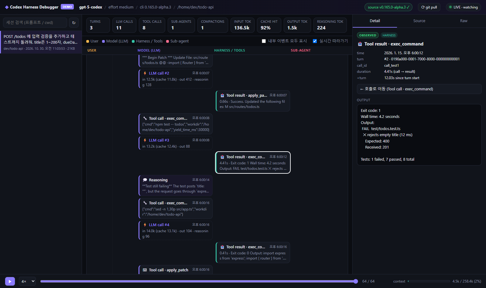
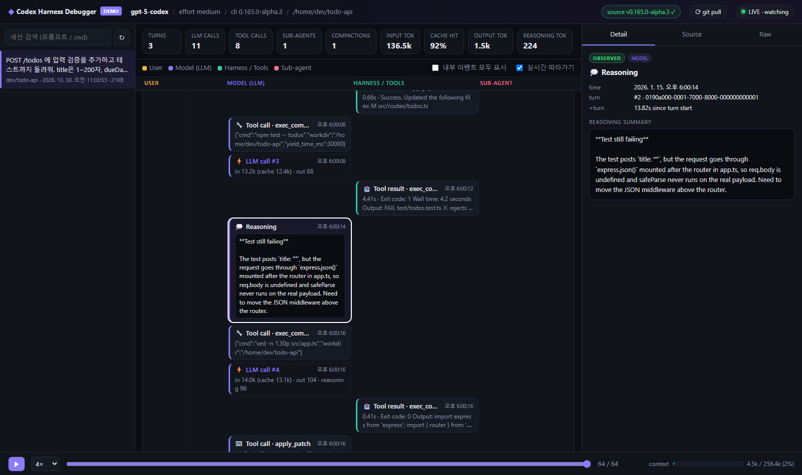
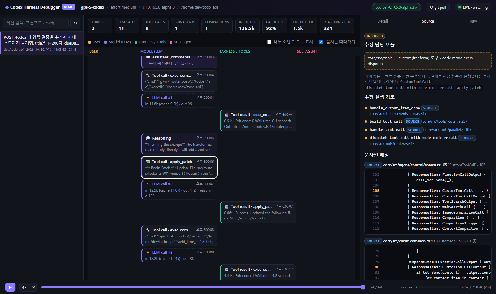
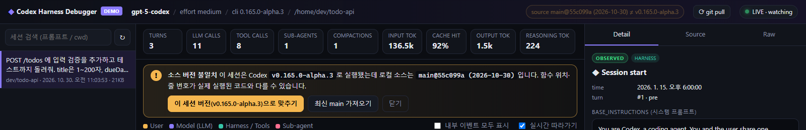

# Codex Harness Debugger

> 프롬프트 하나를 보냈을 때 Codex 하네스 안에서 실제로 무슨 일이 일어나는지 실시간으로 보여주는 비주얼 디버거.

[OpenAI Codex](https://github.com/openai/codex) (CLI · IDE 확장 · 데스크탑 앱)는 세션마다 `~/.codex/sessions/**/rollout-*.jsonl`에 실행 기록을 남깁니다.
이 도구는 그 로그를 읽어서 **LLM 호출, 도구 호출, 하네스가 주입한 컨텍스트, 하위 에이전트, 컨텍스트 압축**을 레인별 타임라인으로 그리고,
각 이벤트를 **Codex Rust 소스의 어느 함수가 처리하는지**까지 연결해 줍니다.

에이전트 하네스가 어떻게 돌아가는지 공부하거나, 내 프롬프트가 모델을 몇 번 불렀는지, 토큰을 얼마나 썼는지, 어디서 시간이 걸렸는지 들여다보는 용도로 쓰세요.

- 의존성 없음: Node.js 하나로 실행 (`npm install` 불필요)
- 읽기 전용: Codex 런타임과 설정은 건드리지 않음
- 로컬 전용: `127.0.0.1`에서만 열리고, 외부로 보내는 데이터 없음 (소스 받을 때 `git`이 GitHub에 접속하는 것 제외)

---

## 화면

### 1. 실행 흐름: 프롬프트 하나가 거치는 모든 단계



- 턴(프롬프트)마다 카드 하나. 헤더에 그 턴의 **LLM 호출 수 · 도구 호출 수 · 소요 시간**이 표시됩니다.
- 4개 레인: **User** / **Model (LLM)** / **Harness · Tools** / **Sub-agent**. 모델과 하네스가 번갈아 주고받는 모습이 보입니다.
- `LLM call #n`은 모델 API를 실제로 1번 호출한 기록입니다. 입력/캐시/출력/추론 토큰이 함께 표시됩니다.
- `Tool call`과 `Tool result`는 `call_id`로 짝지어지고, 실행 시간이 붙습니다. 마우스를 올리면 짝이 함께 강조됩니다.
- `Context → model`: 하네스가 모델에 몰래 넣어 주는 메시지 (권한 안내, AGENTS.md, 환경 정보 등).
- 상단 지표: 전체 LLM 호출 수, 도구 호출 수, 캐시 적중률, 토큰 사용량. 하단 게이지는 컨텍스트 창 사용률입니다.

### 2. 노드 내용 펼쳐 보기



- 노드에 마우스를 올리면 전체 내용이 펼쳐지고 그 안에서 스크롤됩니다. 마우스를 떼면 다시 접힙니다.
- 클릭하면 오른쪽 Inspector에 입력·출력·실행 코드·reasoning 요약·소요 시간이 나옵니다.
- 하단 재생 바로 세션을 처음부터 다시 재생할 수 있습니다 (`Space` 재생, `←` `→` 한 단계씩 이동).

### 3. 이벤트 → Codex 소스 매핑



- **추정 실행 경로**: 이 이벤트가 지나갔을 것으로 보이는 함수들을 순서대로 보여주고, 각 함수의 정의 위치(파일:줄)를 실제 소스에서 찾아 연결합니다. 클릭하면 코드가 열립니다.
- **문자열 매칭**: 관련 심볼이 쓰인 곳. 테스트 코드는 빼고, `core/src`와 정의 줄을 먼저 보여줍니다.

### 소스 버전 확인



세션 로그에는 그 세션을 실행한 Codex 버전(`cli_version`)이 남아 있습니다. 로컬 소스가 그 버전과 다르면 경고 배너가 뜨고,
버튼 한 번으로 그 버전 태그(`rust-v<버전>`)의 소스로 맞추거나 최신 `main`을 받을 수 있습니다. 상단 `⟳ git pull` 버튼은 언제든 최신 소스로 갱신합니다.

### 출처 표시

화면의 모든 정보에는 근거가 표시됩니다. 추정한 내용을 실제 실행 사실처럼 보여주지 않기 위해서입니다.

| 표시 | 의미 |
|---|---|
| `OBSERVED` | 세션 로그에 실제로 기록된 사실 |
| `SOURCE` | 로컬 Codex 소스에서 찾은 코드 위치 |
| `INFERRED` | 이벤트 종류로 추정한 담당 모듈·경로. 실제로 그 함수가 실행됐다는 증거는 아님 |

모델의 추론 전문은 암호화되어 로그에 남지 않습니다. Codex 설정에서 `model_reasoning_summary = "detailed"`이면 요약만 보입니다.

---

## 설치와 실행

필요한 것: [Node.js](https://nodejs.org) 18 이상. 소스 매핑까지 쓰려면 [git](https://git-scm.com)도 필요합니다.

```bash
git clone https://github.com/0-ki/codex-harness-debugger.git
cd codex-harness-debugger
npm start
```

브라우저에서 <http://localhost:4173>을 엽니다. 끝입니다.

1. 왼쪽 목록에 내 Codex 세션들이 최신순으로 나옵니다. 가장 최근 세션이 자동으로 열립니다.
2. Codex(CLI, IDE, 데스크탑 앱 어느 것이든)에서 프롬프트를 보내면 화면에 실시간으로 쌓입니다. 새 세션이 시작되면 자동으로 따라갑니다.
3. 처음 실행하면 상단에 **"Codex 소스가 아직 없습니다"** 배너가 뜹니다. **이 세션 버전으로 맞추기**를 누르면 해당 버전의 Codex 소스를 프로젝트 안 `.codex-src/` 폴더로 받아옵니다 (shallow clone, 약 100MB, 1~2분). 받은 뒤 바로 Source 탭에서 쓸 수 있습니다.

Codex 세션이 아직 없거나 먼저 구경만 하고 싶다면 예제 세션으로 띄워 보세요.

```bash
npm run demo
```

### 명령 정리

| 명령 | 설명 |
|---|---|
| `npm start` | 내 Codex 세션을 보는 디버거 실행 |
| `npm run demo` | 포함된 예제 세션(`examples/`)으로 실행 |
| `npm run sync` | Codex 소스를 최신 `main`으로 받기 (UI 버튼과 같음) |
| `npm run sync -- 0.165.0` | 특정 버전 태그(`rust-v0.165.0`)의 소스 받기 |

### 환경 변수

모두 선택 사항입니다.

| 변수 | 기본값 | 설명 |
|---|---|---|
| `PORT` | `4173` | 서버 포트 |
| `CODEX_HOME` | `~/.codex` | Codex 데이터 폴더. Codex 쪽에서 바꿨을 때만 지정 |
| `CODEX_SRC` | `./.codex-src` | 이미 받아 둔 `openai/codex` 클론이 있으면 그 경로 (저장소 루트나 `codex-rs` 둘 다 가능) |
| `CODEX_SRC_URL` | `https://github.com/openai/codex.git` | 포크나 미러를 쓰고 싶을 때 |

```bash
# macOS / Linux
CODEX_SRC=~/src/codex npm start
```

```powershell
# Windows PowerShell
$env:CODEX_SRC = "$HOME\src\codex"; npm start
```

---

## 동작 방식

```
~/.codex/sessions/**/rollout-*.jsonl ──(0.4초마다 새 줄 읽기, SSE)──▶ 브라우저
                                                                     │
.codex-src/codex-rs/**/*.rs ──(시작 시 메모리 인덱스)──▶ /api/defs, /api/source
```

- `server.js`: 세션 파일 목록과 새 줄 스트리밍, 소스 인덱스 검색, `git` 동기화. 외부 패키지 없이 Node 내장 모듈만 사용합니다.
- `public/model.js`: 로그 레코드를 노드로 변환하고, 이벤트 종류 → 담당 모듈/함수 경로 추정표(`MODULE_HINTS`)를 갖고 있습니다. Codex 내부 구조가 바뀌면 이 표를 고치면 됩니다.
- `public/app.js`, `public/app.css`: UI.

URL 파라미터로 특정 화면을 바로 열 수 있습니다: `?node=22&tab=source` (노드 선택 + 탭), `&hover=23` (노드 펼침).

## 한계

- Codex 세션 로그 형식은 공식 공개 API가 아니라서 버전에 따라 바뀔 수 있습니다. 모르는 이벤트는 Raw로 표시됩니다.
- 실행 경로는 이벤트 종류 기반 추정입니다. 실제 함수 호출을 계측하지 않습니다.
- 공식 진단 기능 `rollout-trace`(`CODEX_ROLLOUT_TRACE_ROOT`, `codex debug trace-reduce`)의 `state.json` 연동은 아직 없습니다.

## 라이선스

MIT. Codex 소스는 이 저장소에 포함되지 않으며, 받을 때 [openai/codex](https://github.com/openai/codex)의 라이선스를 따릅니다.
